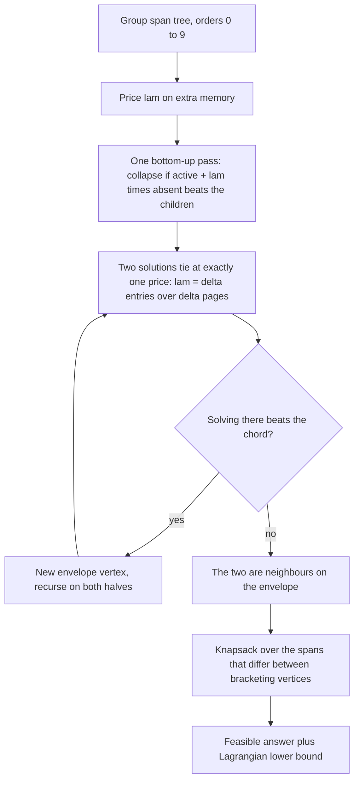
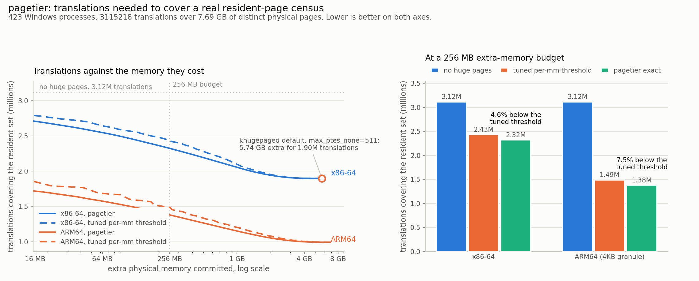

# pagetier

Exact huge-page selection for a real resident-page census: pick which aligned spans
become one translation, under an explicit extra-memory budget, with a certificate
of how close the answer is to optimal.

## The problem

Transparent huge pages are controlled by a handful of global numbers:

```
/sys/kernel/mm/transparent_hugepage/enabled                    on or off
/sys/kernel/mm/transparent_hugepage/hugepages-<size>kB/enabled one switch per order
/sys/kernel/mm/transparent_hugepage/khugepaged/max_ptes_none   default 511 of 512
```

`max_ptes_none=511` means a 2 MB span is collapsed as soon as a single 4 KB page in
it is resident. The other 511 pages are allocated and zeroed whether anything wants
them or not. That is why operational guides for databases and latency-sensitive
services so often say to turn transparent huge pages off: the knob is global, the
decision is local, and nobody measures what it costs.

On a census of 423 live Windows processes taken for this project, the shipped
default wants **5.74 GB of extra physical memory**, on a machine whose entire
resident set occupies 7.69 GB of distinct physical pages. It grows the machine's
physical footprint by 75 percent to remove 39 percent of its translations.

Two further things the global knobs cannot see, both measured here:

- **Most spans are not eligible at all.** A folio must lie inside one mapping of
  uniform protection. Only 12,557 of 53,841 2 MB spans (23.3 percent) pass that
  test, holding 40.0 percent of resident pages. The 1 GB tier is worse: **0 of
  4,963** spans are legal, so it is unreachable, not merely unprofitable.
- **Memory is shared, translations are not.** 3,115,218 translations map only
  2,016,707 distinct pages. One image mapped at one address by 423 processes costs
  its memory once and costs 423 translations. khugepaged scans one mm at a time, so
  it judges a span by one process's page table while the bill is shared.

## What pagetier does

1. **Takes a census.** `QueryWorkingSet` gives the resident page map of every
   process this account can open; `VirtualQueryEx` gives every committed region with
   its protection and backing type. 423 processes, 302,873 regions, 3,115,218
   resident pages. The result is redacted and committed as a 2 MB `data/census.npz`,
   so every number below reproduces offline.
2. **Groups spans by what backs them.** Two processes mapping the same image at the
   same address share the physical pages, so the extra memory a folio costs is paid
   once for the group while the translations it saves accrue to every member. The
   grouping is inferred from address and backing type alone, never from the kernel's
   shared flag, which leaves that flag free as an independent check: the system calls
   97.4 percent of the resident pages in multi-mapper groups shared, against 11.3
   percent elsewhere.
3. **Solves the selection exactly.** The candidate spans of an address space nest, so
   they form a laminar family and a solution is a cut through a tree. At a fixed
   price on memory the optimum is one bottom-up pass; sweeping the price with the
   Eisner and Severance parametric method enumerates every vertex of the lower convex
   envelope, and a bounded knapsack over the spans that differ between bracketing
   vertices closes the integrality gap. Both sweeps here run to completion (1,340 and
   2,302 vertices), so the result is not a sample of the frontier but all of it.
4. **Compares against what ships.** The baseline is the lower envelope of a whole
   family of threshold policies, with an independent density threshold per order and
   the largest enabled order tried first. That family is a strict superset of what
   the sysfs knobs can express, so beating it is a stronger statement than beating
   any one configuration.

## Why this is interesting

The usual framing is that huge pages trade memory for TLB reach and you pick a
setting. The measurements say something sharper.

- The architecture decides most of the outcome. ARM64's contiguous-PTE hint folds 16
  adjacent entries into one, and 75.3 percent of 64 KB spans are legal against 23.3
  percent of 2 MB spans. At **zero extra memory** that removes 39.4 percent of the
  machine's translations on ARM64 and 5.1 percent on x86-64. Same census, same
  policy, different ladder.
- A density threshold is the right order only when the cost of a span is a function
  of that span's own density. Once memory is shared it is not: the benefit follows
  the sum over mappers and the cost follows their union, so the ratio stops being
  monotone and the threshold stops being optimal.
- The exact solver's distinguishing output is the bound, not the win. At a 256 MB
  budget it lands 0.0100 percent (x86-64) and 0.0012 percent (ARM64) above a
  certified lower bound, so the remaining headroom for any method at all is known
  and nearly nil.
- Part of the default's bill buys nothing measurable. The fewest translations the
  2 MB ladder can reach is 1,897,262, and that point costs 5.27 GB, so **0.47 GB of
  the default's 5.74 GB is spent on collapses that remove no translation at all**.
- Tiers can be ruled out rather than skipped. 1 GB has no legal span anywhere in the
  census. The 32 MB contiguous-PMD tier has 598 legal spans, but a contiguous-PMD
  mapping replaces 16 entries with one, so its best possible return is 0.1649
  translations per extra page, below the frontier's marginal price at every budget
  reported. Leaving both out of the search is a proof, not an omission.

## Architecture

[FigJam board: pagetier architecture](https://www.figma.com/board/27t9JTjXPhvYDkY94oQBQM)

The board shows the path from two Windows page-map calls to a certified frontier:
census, tiling, sharing groups, the per-order pyramid, then the two consumers of it,
the threshold policies that ship and the exact solver, meeting at a matched-budget
comparison.

The solver itself is four steps:



The recurrence at the heart of it, for a span of order k holding `union` resident
pages across `active` members whose children are already solved:

```
f(span) = min( active + lam * (2**k - union)      if the span is legal in every member,
               sum of f(child) )
```

A leaf is worth one translation per member that has the page resident and costs
nothing. Because every candidate span is a node of this tree, the minimum over all
laminar cuts is the value at the root, exactly, in one pass.

## Results



The metric is **translations needed to cover the resident set**: the number of leaf
page-table mappings the hardware must hold, which is what huge pages exist to
reduce. The baseline is what a kernel can do today, taken as the lower envelope of
the whole per-mm threshold family rather than one shipped setting, so it is already
tuned. Both policies are measured on the same census and charged the same way, with
shared memory billed once.

At a 256 MB extra-memory budget:

| | no huge pages | khugepaged default | tuned per-mm threshold | union threshold | pagetier | lower bound |
|---|---|---|---|---|---|---|
| x86-64 | 3,115,218 | 1,897,262 at 5.74 GB | 2,434,812 | 2,379,314 | **2,323,998** | 2,323,767 |
| ARM64 4 KB granule | 3,115,218 | 1,897,262 at 5.74 GB | 1,491,479 | 1,449,890 | **1,380,223** | 1,380,206 |

pagetier needs 4.6 percent fewer translations than the tuned threshold on x86-64 and
7.5 percent fewer on ARM64, for the same memory. The shipped default is not a
candidate at this budget at all: it wants 23 times more memory than the budget
allows.

The gap splits cleanly into two causes. Switching the decision from one process's
page table to the union across mappers, with no change of algorithm, recovers 37
percent of the ARM64 gap (1,491,479 to 1,449,890). Solving the nested orders exactly
rather than by a per-order threshold recovers the other 63 percent. So roughly a
third of the win is from modelling the sharing and two thirds from the solver.

What the frontier adds beyond a number is the certificate. Both parametric sweeps
terminated with every vertex found, and the refined answer sits 0.0100 percent
(x86-64) and 0.0012 percent (ARM64) above the Lagrangian bound at 256 MB. No policy,
exact or otherwise, can do meaningfully better at that budget.

The honest limits:

- This is a policy evaluation on a real resident-page census, not a live kernel A/B.
  The census is Windows, which has no transparent huge pages; it is used because it
  will hand a normal user the exact page maps and region attributes the policy needs,
  for hundreds of real processes at once.
- A folio is only credited when the span is legal in every member of its sharing
  group. That is a restriction, so the reported result is a lower bound on what the
  same method could reach with per-member mapping decisions.
- Translations are counted, not weighted by how often each is used. Without an access
  trace a hot translation and a cold one count the same.

## How to run it

```
pip install -r requirements.txt

python scripts/run_demo.py          # full study on the committed census, about 90 s
python scripts/make_chart.py        # redraws docs/before_after.png from docs/results.json
python -m pytest tests -q           # solver checks against exhaustive enumeration
```

`run_demo.py` reads `data/census.npz`, which is committed, so it reproduces every
number in this README on any platform with no privileges and no network.

To take a fresh census from your own machine (Windows only, no elevation needed):

```
python scripts/collect_census.py --out data/census.npz
python scripts/run_demo.py
```

Use the library directly:

```python
from pagetier import arch, corpus, exact, policy

c = corpus.load("data/census.npz")
model = exact.Model(c, arch.ARM64_4K)
front = exact.frontier(model)                       # every envelope vertex
answer = exact.refine_at_budget(front, 256 * 256)   # budget in 4 KB pages
print(answer["entries"], answer["bound"])

ev = policy.PolicyEvaluator(c, arch.ARM64_4K)
print(ev.khugepaged(511).entries, ev.khugepaged(511).waste_bytes)
```

## Example output

From `python scripts/run_demo.py` on the committed census:

```
census: 423 processes, 53841 tiles, 3115218 translations over 2016707 distinct pages
        (11.88 GB mapped, 7.69 GB physical)
sharing: 1937 of 27030 groups have more than one mapper, largest 423; the system
        itself calls 97.4% of their resident pages shared against 11.3% elsewhere

verifying the solver
  tree recurrence against 9577 enumerated laminar cuts: max error 0

=== ARM64 (4KB granule), orders that fold into one translation: 4KB, 64KB contpte,
    2MB, 32MB contpmd, 1GB
  order 4  (64KB contpte )  460368 spans with residency,  346584 legal (75.3%),
                            covering 2576432 resident pages (82.7%)
  order 9  (2MB          )   53841 spans with residency,   12557 legal (23.3%),
                            covering 1246215 resident pages (40.0%)
  order 13 (32MB contpmd )   12415 spans with residency,     598 legal
  order 18 (1GB          )    4963 spans with residency,       0 legal
                            (tier unreachable, left out of the search)
  no huge pages                          3115218 translations, 0 extra
  khugepaged default (max_ptes_none=511) 1897262 translations, 5.74 GB extra
  threshold envelopes: 126 per-mm points, 120 union points (50.9s)
  parametric frontier: 2302 vertices from 4603 solves, complete=True (25.0s)
  order 13 (32MB contpmd) left out of the search: 598 legal spans, best possible
                            0.1649 translations per extra page
      0 MB  per-mm   1931466 | union   1888392 | pagetier   1888392  (gap 0.0000%)
     64 MB  per-mm   1687535 | union   1646917 | pagetier   1576341  (gap 0.0026%)
    256 MB  per-mm   1491479 | union   1449890 | pagetier   1380223  (gap 0.0012%)
   1024 MB  per-mm   1207501 | union   1187186 | pagetier   1151182  (gap 0.0003%)
   4096 MB  per-mm   1005358 | union   1002372 | pagetier    998672  (gap 0.0005%)
  solver check: scalar reference on 150 groups, max error 0; exact budgeted table on
                a 30 group slice gives 1257 against 1257 from the frontier
```

The three checks that gate those numbers are independent of the solver they check:

- the tree recurrence is compared against exhaustive enumeration of every laminar
  cut on small synthetic groups, 9,577 cuts, zero error;
- the vectorised solver is compared against a scalar Python solve of 150 sampled
  real groups at five prices, zero error;
- the parametric frontier plus its refinement is compared against a budget-indexed
  exact table built from each group's full Pareto set on a 30 group slice, which
  shares no code path with it: 2,399 against 2,399 on x86-64 and 1,257 against 1,257
  on ARM64.

## Layout

```
pagetier/census.py    Windows page-map reader, ctypes only
pagetier/corpus.py    tiling, sharing groups, order pyramids, legality
pagetier/arch.py      which orders each architecture folds into one translation
pagetier/exact.py     Lagrangian tree DP, parametric frontier, budget refinement
pagetier/policy.py    per-mm and union threshold families, khugepaged default
pagetier/verify.py    the three checks above
data/census.npz       the committed, redacted census
docs/results.json     every number this README quotes
```

## Privacy of the committed census

The census carries region addresses, sizes, protection codes and residency bitmaps.
It carries no file paths, no command lines and no memory contents. Process names are
kept only when they appear in a fixed list of widely distributed binaries; anything
else is recorded as `other`. Addresses are from one boot of one machine and are
randomised per boot.
